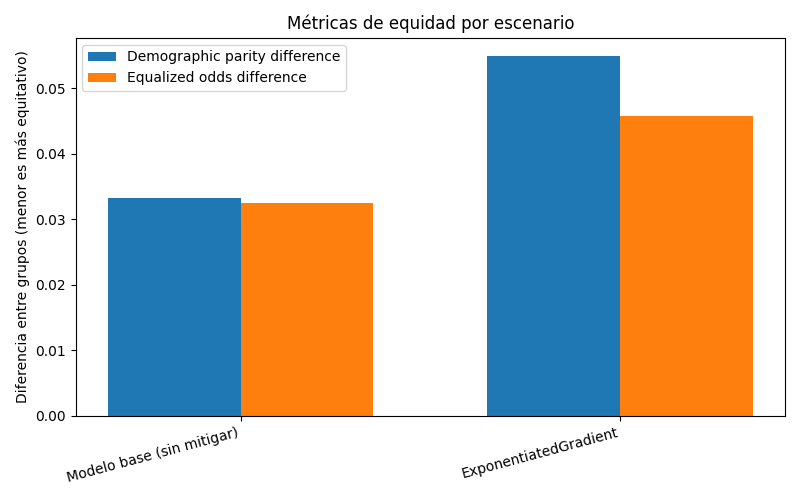
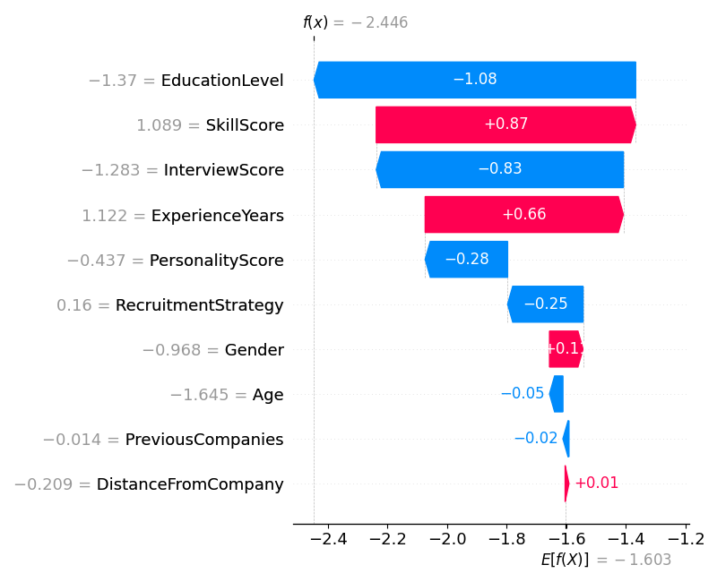
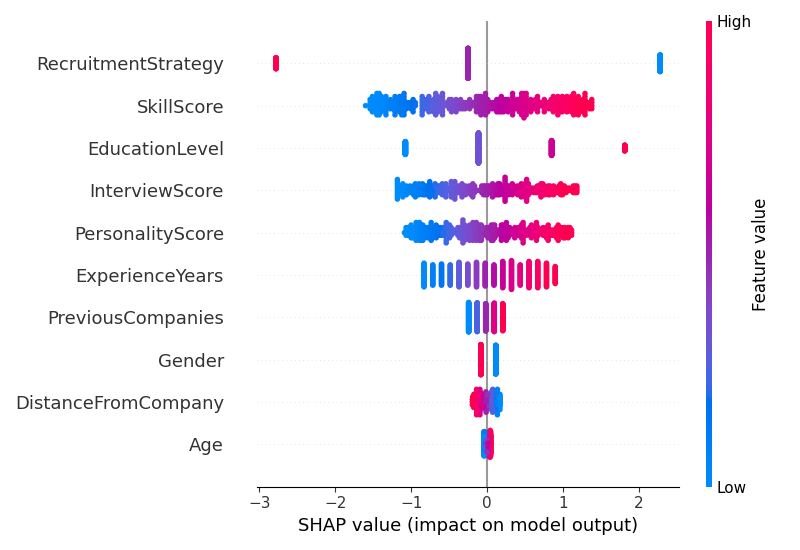

# Evidencias — Auditoría de equidad, mitigación y explicabilidad

_Generado automáticamente el 2026-10-17 01:39._

## Configuración de la corrida

- **Dataset:** data/recruitment_data.csv
- **Columna objetivo:** `HiringDecision` (clase positiva: `1`)
- **Atributo sensible:** `Gender`
- **Método de mitigación:** `exponentiated_gradient`
- **Restricción de equidad:** `demographic_parity`

## Auditoría de equidad — modelo base (pre-mitigación)

- **Exactitud global:** 0.873
- **Demographic parity difference:** 0.033
- **Equalized odds difference:** 0.032

### Métricas por grupo

| Grupo | Exactitud | Tasa de selección |
|---|---|---|
| 0 | 0.873 | 0.236 |
| 1 | 0.874 | 0.270 |

> El modelo obtuvo una exactitud global del 87,3 %, con resultados muy similares entre los dos grupos de género. Sin embargo, se observa una pequeña diferencia en las tasas de selección: el grupo 0 obtuvo un 23,6 % de predicciones positivas y el grupo 1 un 27 %. Esta diferencia se refleja en el valor de Demographic Parity Difference de 0,033. Aunque la disparidad es relativamente baja, demuestra la importancia de evaluar la equidad de los modelos. A diferencia del caso de Amazon, donde se documentó un sesgo que perjudicaba a las mujeres, en este dataset sintético no encontramos evidencia suficiente para afirmar que exista una discriminación similar.

## Comparación antes / después de la mitigación

| Escenario | Exactitud | Demographic parity diff. | Equalized odds diff. |
|---|---|---|---|
| Modelo base (sin mitigar) | 0.873 | 0.033 | 0.032 |
| ExponentiatedGradient | 0.867 | 0.055 | 0.046 |

> La técnica ExponentiatedGradient no logró mejorar los resultados de equidad en esta ejecución. Aunque su objetivo era reducir las diferencias entre grupos, Demographic Parity Difference aumentó de 0,033 a 0,055 y Equalized Odds Difference pasó de 0,032 a 0,046. Además, la exactitud disminuyó del 87,3 % al 86,7 %. Esto demuestra que aplicar una técnica de mitigación no garantiza obtener mejores resultados, especialmente cuando las diferencias iniciales ya son pequeñas. Por eso, es importante comparar distintas métricas antes de decidir si conviene utilizar el modelo mitigado.

## Explicabilidad (SHAP) — modelo base

SHAP se aplica siempre sobre el modelo base, antes de cualquier mitigación: el objetivo es ver qué técnica de auditoría preventiva podría haber detectado el problema antes del despliegue (consigna 4).

### Caso 1 — Mayor influencia del atributo sensible

- Contribución absoluta de `Gender`: 0.112
- Predicción del modelo: 0 · Valor real: 0

### Caso 2 — Menor influencia del atributo sensible

- Contribución absoluta de `Gender`: 0.085
- Predicción del modelo: 1 · Valor real: 1

### Resumen global

> El análisis con SHAP permitió identificar la influencia del atributo sensible Gender en las predicciones del modelo. En el primer caso, su contribución fue de aproximadamente +0,112, mientras que en el segundo fue de -0,085. Esto demuestra que el género puede influir de manera diferente según el candidato, aunque en ambos casos otras variables tuvieron mayor importancia. Además, el gráfico de resumen global muestra que Gender se encuentra entre las características de menor influencia del modelo. Por lo tanto, SHAP podría utilizarse como una herramienta de auditoría preventiva para detectar variables sensibles que afectan las decisiones. Sin embargo, sus resultados deben complementarse con métricas de equidad como las calculadas mediante Fairlearn, ya que la influencia de una variable no demuestra por sí sola la existencia de discriminación.
