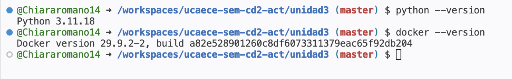
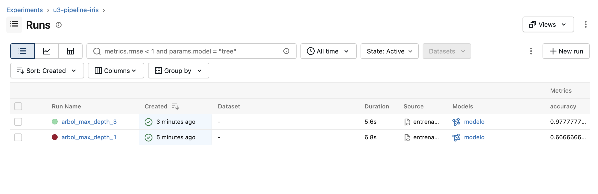
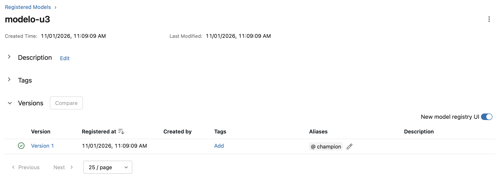
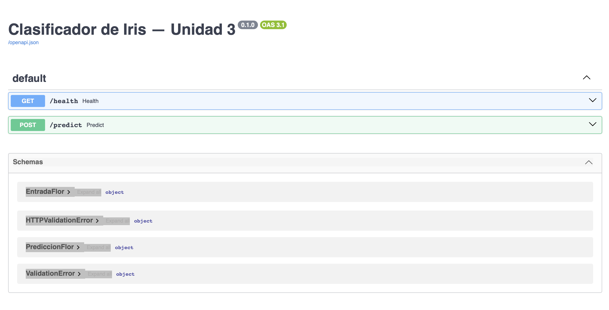
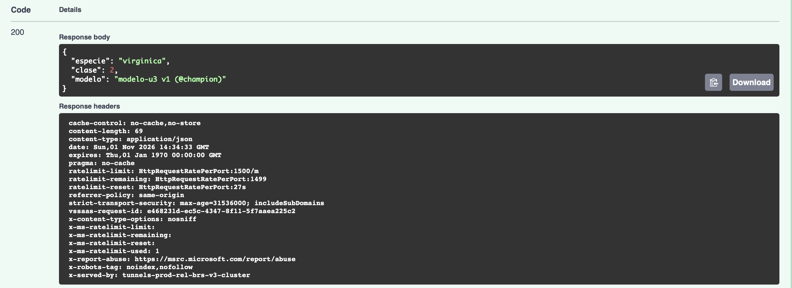
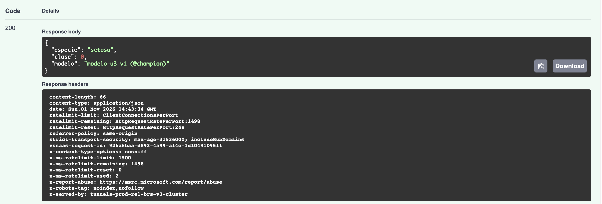
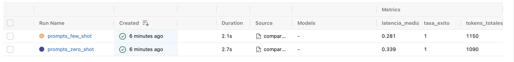

# Resultados — Unidad 3: MLOps/LLMOps

**Estudiante:** <!-- Completar con tu nombre y apellido -->
**Fecha:** <!-- Completar con la fecha de entrega -->

---

## Consigna 6: Preparación del entorno

---

## Consigna 7: Experimentación y registro con MLflow

| Corrida | max_depth | accuracy | f1_macro |
|---------|-----------|----------|----------|
| arbol_max_depth_1 | 1 | 0.667 | 0.556 |
| arbol_max_depth_3 | 3 | 0.978 | 0.978 |

**Versión registrada:** modelo-u3 v__ (@champion), corrida con max_depth = 3

> Se entrenaron dos árboles de decisión utilizando el dataset Iris y se registraron los experimentos mediante MLflow. El modelo con profundidad 1 obtuvo un accuracy de 0.667 y un F1-macro de 0.556, mientras que el modelo con profundidad 3 alcanzó 0.978 en ambas métricas. Por este motivo, se seleccionó el segundo modelo como el de mejor rendimiento y se registró en MLflow con el nombre modelo-u3, versión 1 y alias champion.

---

## Consigna 8: Serving con FastAPI

| Entrada | Respuesta de la API |
|---------|---------------------|
| Setosa (5.1, 3.5, 1.4, 0.2) | HTTP 200 - setosa (clase 0) |
| Versicolor (6.0, 2.7, 4.5, 1.4) | HTTP 200 - versicolor (clase 1) |
| Virginica (6.9, 3.1, 5.8, 2.2) | HTTP 200 - virginica (clase 2) |
| Entrada inválida ("abc") | HTTP 422 - Error de validación |

> Se utilizó FastAPI para publicar el modelo entrenado mediante una API REST. Se realizaron pruebas con las tres especies del dataset Iris y se obtuvieron respuestas correctas, con código HTTP 200. También se probó una entrada inválida, ingresando texto en lugar de un número, y la API devolvió un error 422. Esto permitió comprobar que el modelo realiza las predicciones correctamente y que la API valida los datos antes de procesarlos.

---

## Consigna 9: Containerización con Docker

> Se construyó una imagen Docker llamada modelo-u3:1.0, que incluye la API desarrollada con FastAPI y el modelo exportado. Luego se ejecutó el contenedor y se comprobó que la aplicación seguía realizando predicciones correctamente, obteniendo una respuesta HTTP 200 para una flor de la especie setosa. Para publicar una futura versión modelo-u3:1.1, utilizaría una estrategia blue-green deployment. Esta consiste en mantener funcionando la versión actual mientras se prepara y prueba la nueva. Una vez verificado su funcionamiento, se redirigen las solicitudes a la nueva versión. De esta manera, se busca evitar interrupciones del servicio y se puede volver a la versión anterior si aparece algún problema.

---

## Paso opcional: LLMOps con Groq

| Plantilla | tasa_exito | tokens_totales | latencia_media_s |
|-----------|------------|----------------|------------------|
| zero_shot |            |                |                  |
| few_shot  |            |                |                  |

> Escribí acá tu interpretación (2 a 3 líneas).
